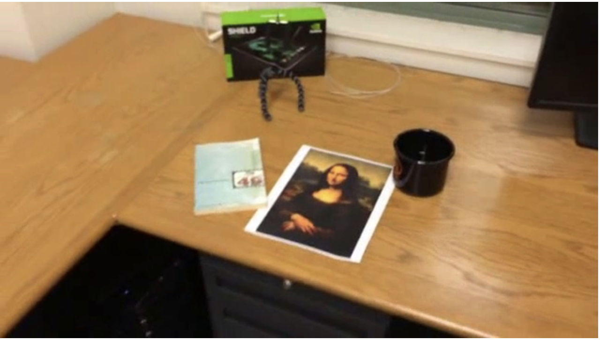

# Отчет_лр_2

# ЛР2. Трекинг плоского объекта на видео по ключевым точкам

Программа принимает видео, первый кадр которого — крупное изображение объекта, и на каждом следующем кадре рисует вокруг объекта рамку с подписью. Рамка повторяет перспективу объекта (четырёхугольник, а не прямоугольник).

## 1. Теоретическая база

**Ключевые точки и дескрипторы.** Ключевая точка — «приметное» место изображения (угол, пятно, резкий перепад яркости), которое можно найти снова после поворота, масштабирования или смены освещения. Дескриптор — числовой «отпечаток» окрестности точки. Использован **SIFT** (Scale-Invariant Feature Transform): он ищет точки на разных масштабах, задаёт каждой ориентацию и описывает её вектором из 128 чисел. Точки появляются только на текстурных участках, поэтому для трекинга нужны объекты с богатым рисунком.

**Сопоставление и ratio test.** Для каждой точки шаблона ищутся два ближайших по дескриптору кандидата на кадре (`BFMatcher.knnMatch`, k=2). Пара сохраняется, только если лучший кандидат заметно ближе второго: `d1 < 0.75 · d2`. Это отсеивает большинство случайных совпадений.

**Гомография.** Изображения плоского объекта, снятого с разных ракурсов, связаны проективным преобразованием — матрицей H размером 3×3:

```
[x' y' w']ᵀ = H · [x y 1]ᵀ,   точка на кадре = (x'/w', y'/w')
```

Деление на w’ даёт перспективу. В матрице 8 независимых параметров, каждая пара точек даёт 2 уравнения, поэтому нужно минимум 4 пары. Преобразование корректно только для плоских объектов.

**RANSAC и inliers.** Даже после ratio test часть пар ошибочна. RANSAC многократно строит гомографию по 4 случайным парам и выбирает ту, с которой согласно больше всего пар. Согласные пары (точка, перенесённая через H, попадает ближе 5 пикселей к своей паре) называются **inliers**, остальные — выбросами. Число inliers показывает, насколько можно доверять найденной рамке.

## 2. Описание системы

Объект ищется заново на каждом кадре (детекция, а не отслеживание между кадрами).

```
первый кадр → шаблон → SIFT (один раз)
для каждого кадра:
  SIFT → knnMatch с шаблоном → ratio test → findHomography (RANSAC)
  → проверки → перенос 4 углов шаблона через H → рамка и подпись → запись кадра
```

Код состоит из двух функций:

- `getAngles(img, kp1, desc1, pts, sift, bf)` — ищет объект на одном сером кадре. Возвращает 4 угла рамки и число inliers либо `None, 0`, если объект не найден.
- `full_work(inputPath, outputPath, title)` — обрабатывает видео целиком: берёт шаблон из первого кадра, вызывает `getAngles` для каждого кадра, рисует рамку, записывает выходное видео и возвращает число inliers по кадрам.

Объект считается **не найденным** в любом из случаев:

| Проверка | Значение |
| --- | --- |
| на кадре меньше 2 ключевых точек | — |
| хороших пар после ratio test | ≤ `MIN_MATCH_COUNT` = 10 |
| гомография не найдена или inliers | < `MIN_INLIERS` = 6 |
| рамка невыпуклая | `cv2.isContourConvex` |
| площадь рамки | < `MIN_AREA` = 500 px² |

Последние две проверки добавлены после того, как на смазанных кадрах RANSAC собирал гомографию из случайных пар и рисовал вырожденный «клин» через полкадра. Настоящий плоский прямоугольник под любым углом остаётся выпуклым четырёхугольником заметной площади.

Параметр SIFT `contrastThreshold` уменьшен с 0.04 до 0.02, чтобы находить больше точек.

## 3. Результаты

### Разбор одного кадра (кадр 150 тестового видео)

| Этап | Количество |
| --- | --- |
| Ключевых точек на шаблоне | 316 |
| Пар после `knnMatch` | 316 |
| Пар после ratio test | 12 |
| Inliers после RANSAC | 6 |

Картина на этом кадре примерно в 4–5 раз меньше, чем на шаблоне, и видна под углом. Поэтому пар мало, но шести inliers хватило для точной рамки.




### Видео

Тестовые видео: 640×360, 29.97 кадра/с, 557 кадров.

| Видео | Объект найден | Комментарий |
| --- | --- | --- |
| `mona-lisa` | 282 / 557 (50.6%) | теряется, когда камера далеко |
| `mona-lisa-blur` | 280 / 557 (50.3%) | почти без потерь на размытии |
| `mona-lisa-blur-extra-credit` | 259 / 557 (46.5%) | сильное размытие, потери больше |
| своё видео (открытка), 480×854, 734 кадра | 556 / 734 (75.7%) | объект крупный, фон текстурный |


**Эксперимент с `contrastThreshold`.** Значение 0.02 вместо 0.04 увеличило число inliers на близких кадрах (около 600 против 250), но на дальних кадрах не помогло: доля кадров с найденным объектом 50.6% против 51.7%. Более чувствительный детектор находит больше точек там, где детали есть, но не может создать их там, где их физически нет.

**Своё видео.** Исходник с телефона уменьшен до ширины 480 пикселей (`ffmpeg -vf scale=480:-2`), иначе обработка шла слишком медленно. Обработка 734 кадров заняла около 15 минут, то есть примерно 1.2 с на кадр. Объект найден на 75.7% кадров. Это лучше, чем на тестовых видео: открытка в кадре крупнее и снята ближе.


## 4. Выводы

1. Связка SIFT + ratio test + гомография с RANSAC точно находит плоский объект вблизи и под большим углом. Рамка повторяет перспективу объекта.
2. Главное ограничение — **видимый размер объекта**. Число inliers падает вместе с размером, и при размере объекта около 40×60 пикселей деталей для SIFT не остаётся.
3. Второе ограничение — **размытие**: оно стирает перепады яркости, на которых строятся ключевые точки. Чем сильнее размытие, тем больше потерянных кадров (50.6% → 50.3% → 46.5%).
4. Шаблон должен содержать только объект: текстурный фон в первом кадре (плед на своём видео) попадает в шаблон, искажает рамку и замедляет сопоставление.

## 5. Использованные источники

1. [https://docs.opencv.org/3.4.20/d1/de0/tutorial_py_feature_homography.html](https://docs.opencv.org/3.4.20/d1/de0/tutorial_py_feature_homography.html)
2. [https://docs.opencv.org/4.13.0/d2/d96/tutorial_py_table_of_contents_imgproc.html](https://docs.opencv.org/4.13.0/d2/d96/tutorial_py_table_of_contents_imgproc.html)
3. [https://www.geeksforgeeks.org/python/python-opencv-drawkeypoints-fuction/](https://www.geeksforgeeks.org/python/python-opencv-drawkeypoints-fuction/)
4. [https://www.geeksforgeeks.org/python/saving-a-video-using-opencv/](https://www.geeksforgeeks.org/python/saving-a-video-using-opencv/)
