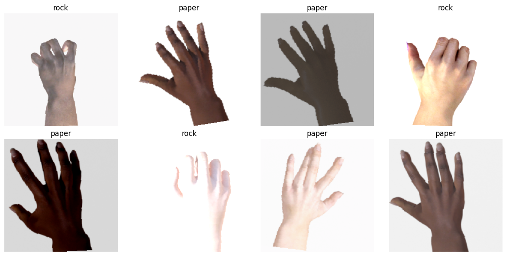
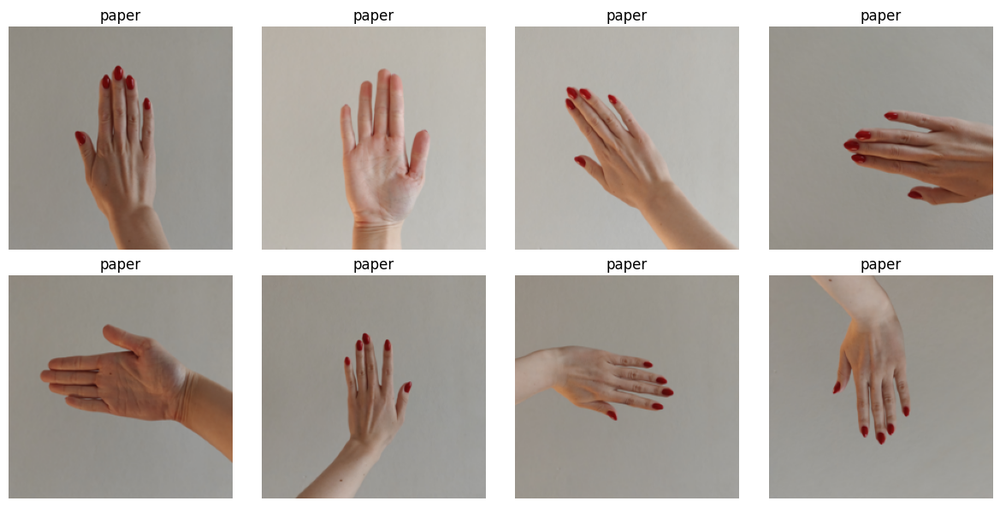
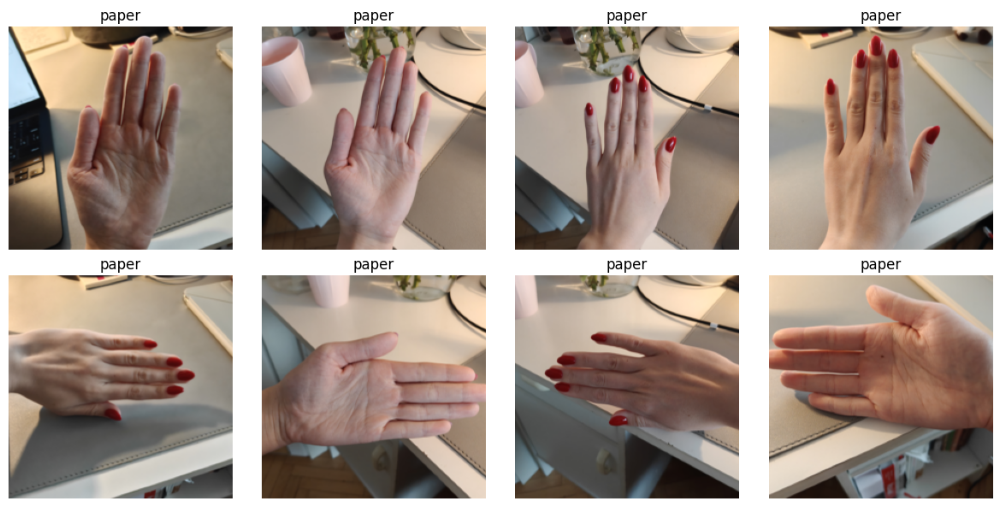
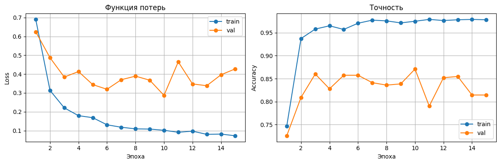
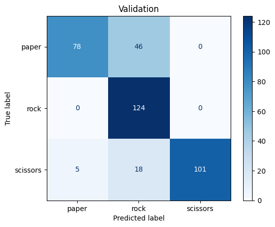
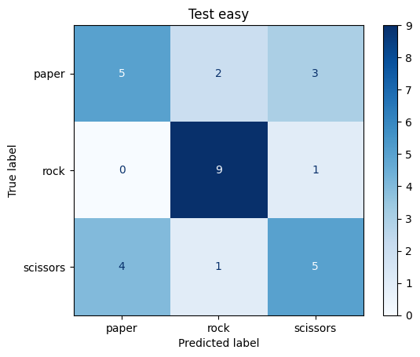
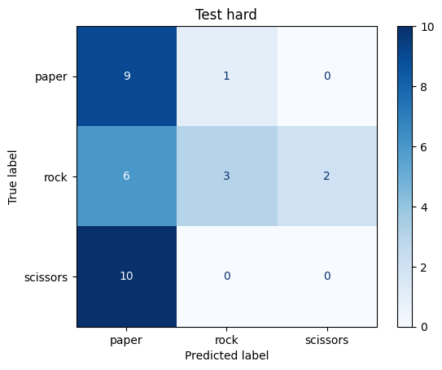

# ЛР3. Классификация жестов «камень — ножницы — бумага» с помощью свёрточной нейронной сети

**Цель работы:** научиться создавать простые системы классификации изображений на основе свёрточных нейронных сетей.

**Задача:** по фотографии руки определить, какой жест показан: **камень** (`rock`), **ножницы** (`scissors`) или **бумага** (`paper`).

Модель обучалась на синтетическом датасете (компьютерные 3D-модели рук на белом фоне), а тестировалась на собственных фотографиях, снятых на телефон. Так можно проверить, насколько модель, обученная на «идеальных» данных, переносится на реальные условия.

Исходный код находится в ноутбуке [`CV_lab3.ipynb`](CV_lab3.ipynb).

---

## Содержание

1. [Теоретическая база](#1-теоретическая-база)
2. [Описание разработанной системы](#2-описание-разработанной-системы)
3. [Результаты работы и тестирования](#3-результаты-работы-и-тестирования)
4. [Выводы](#4-выводы)
5. [Использованные источники](#5-использованные-источники)

---

## 1. Теоретическая база

**Свёрточная нейронная сеть (CNN)** обрабатывает изображение небольшими ядрами (например, 3×3), которые скользят по картинке и выделяют признаки: края, текстуры, формы. Значения ядер подбираются при обучении. В отличие от полносвязной сети, одно ядро применяется по всему изображению, поэтому параметров намного меньше. Между свёртками стоят функция активации **ReLU** (`max(0, x)`), которая добавляет нелинейность, и **пулинг**, который уменьшает размер карт признаков.

**ResNet18** — свёрточная сеть из 18 слоёв с остаточными связями (skip connections), предобученная на ImageNet (1000 классов).

**Перенос обучения (transfer learning):** берём сеть, уже обученную на большом датасете, заменяем последний слой под свои классы и дообучаем на небольшом датасете. Признаки, выученные на ImageNet, подходят и для новой задачи.

**Выборки:** train — на ней сеть учится; validation — проверка после каждой эпохи, чтобы отследить переобучение; test — итоговая проверка на новых данных.

**Переобучение:** модель запоминает обучающие примеры вместо общих закономерностей. Признак: loss на train падает, а на validation перестаёт снижаться или растёт.

**Аугментации** — случайные изменения обучающих картинок (повороты, отражения, яркость), которые уменьшают переобучение.

**Функция потерь и метрики:** `CrossEntropyLoss` — стандартный loss для классификации; accuracy — доля верных ответов; матрица ошибок показывает, какие классы модель путает.

**Сдвиг домена (domain shift):** если данные для обучения и применения сильно различаются (здесь синтетические руки и реальные фото), качество модели падает.

---

## 2. Описание разработанной системы

### 2.1. Данные

**Train и validation:** датасет [Rock Paper Scissors](https://www.kaggle.com/datasets/frtgnn/rock-paper-scissor) с Kaggle (исходный автор Laurence Moroney). Изображения сгенерированы на компьютере: 3D-модели рук разных оттенков кожи на белом фоне.

| Выборка | Источник | paper | rock | scissors | Всего |
|---|---|---|---|---|---|
| Train | `rps/rps` | 840 | 840 | 840 | 2520 |
| Validation | `rps-test-set/rps-test-set` | 124 | 124 | 124 | 372 |
| Test easy | собственные фото | 10 | 10 | 10 | 30 |
| Test hard | собственные фото | 10 | 11 | 10 | 31 |

Часть датасета, которую авторы называют `rps-test-set`, в этой работе используется как **валидационная** выборка. Тестовая выборка собрана самостоятельно, в соответствии с заданием.

**Test (собственные фотографии, 61 изображение).** Фотографии руки сняты на телефон и вручную разложены по папкам классов. Тест разделён на две части, чтобы оценить влияние условий съёмки:
- **test easy:** рука на светлом однотонном фоне, условия ближе к датасету;
- **test hard:** разные фоны (рабочий стол с предметами), разное освещение, ракурсы и расстояние.

Метка класса определяется названием папки (`paper`, `rock`, `scissors`), что соответствует формату `torchvision.datasets.ImageFolder`.

<p align="center"><br><i>Примеры обучающих изображений после аугментаций</i></p>

<p align="center"><br><i>Примеры из test easy (однотонный фон)</i></p>

<p align="center"><br><i>Примеры из test hard (разные фоны и освещение)</i></p>

### 2.2. Предобработка

Предобработка для валидации и теста совпадает с той, на которой ResNet18 обучалась на ImageNet (взята из `ResNet18_Weights.IMAGENET1K_V1.transforms`):

```
Resize(256) → CenterCrop(224) → ToTensor() → Normalize(mean=[0.485, 0.456, 0.406], std=[0.229, 0.224, 0.225])
```

Для обучающей выборки дополнительно применяются аугментации:

| Аугментация | Параметры | Обоснование |
|---|---|---|
| `RandomHorizontalFlip` | p = 0.5 | Отражённая рука показывает тот же жест; заодно имитирует левую руку |
| `RandomRotation` | ±10°, `fill=255` | Руку держат под разными углами; углы заполняются белым, как фон датасета |
| `ColorJitter` | brightness = 0.5, contrast = 0.5, saturation = 0.1 | Освещение и цвет на реальных фото отличаются от синтетических |

`RandomVerticalFlip` не используется: жест «пальцами вниз» в реальных условиях почти не встречается.

### 2.3. Архитектура модели

- Базовая сеть: **ResNet18**, предобученная на ImageNet (`IMAGENET1K_V1`).
- Все слои сети **заморожены** (`requires_grad = False`), признаки ImageNet используются без изменений.
- Последний слой `fc` (512 → 1000) заменён на новый `Linear(512, 3)` со случайной инициализацией.
- Обучаемых параметров: **1539** (512 × 3 весов + 3 смещения) из ~11.2 млн.

```
Изображение 3×224×224 → [ResNet18, заморожена] → вектор признаков 512 → Linear(512, 3) → оценки для paper / rock / scissors
```

### 2.4. Обучение

| Параметр | Значение |
|---|---|
| Функция потерь | `CrossEntropyLoss` |
| Оптимизатор | `Adam`, lr = 0.001 (только параметры нового слоя `fc`) |
| Размер батча | 32 |
| Число эпох | 15 |
| Метрики | accuracy, confusion matrix |

**Алгоритм обучения.** На каждой эпохе:
1. модель переводится в режим обучения (`model.train()`);
2. для каждого батча: прямой проход → вычисление loss → обнуление градиентов → обратное распространение ошибки (`loss.backward()`) → шаг оптимизатора;
3. считаются средние loss и accuracy на train;
4. модель переводится в режим оценки (`model.eval()`), и в режиме `torch.no_grad()` считаются loss и accuracy на validation;
5. значения сохраняются для построения графиков.

Оценка на валидации и тесте выполняется одной функцией `evaluate(model, loader)`. Тестовые выборки используются только после окончания обучения.

### 2.5. Системные требования

- Python 3.10+
- PyTorch, torchvision
- scikit-learn (матрица ошибок)
- matplotlib (графики)
- kagglehub (загрузка датасета)
- Рекомендуется GPU. Работа выполнялась в **Google Colab** с GPU (CUDA). Обучение 15 эпох занимает несколько минут.

### 2.6. Запуск

1. Открыть `CV_lab3.ipynb` в Google Colab и включить GPU: «Среда выполнения → Сменить среду выполнения».
2. Датасет загружается автоматически через `kagglehub`.
3. Положить тестовые фотографии на Google Drive в структуру:
   ```
   cv_test_photos/
   ├── test_easy/
   │   ├── paper/
   │   ├── rock/
   │   └── scissors/
   └── test_hard/
       ├── paper/
       ├── rock/
       └── scissors/
   ```
   При необходимости поправить пути `test_easy_path` и `test_hard_path`.
4. Выполнить «Среда выполнения → Выполнить все».

---

## 3. Результаты работы и тестирования

### 3.1. Кривые обучения

<p align="center"><br><i>Loss и accuracy на обучающей и валидационной выборках по эпохам</i></p>

| Эпоха | Train loss | Train acc | Val loss | Val acc |
|---|---|---|---|---|
| 1 | 0.690 | 0.747 | 0.625 | 0.726 |
| 3 | 0.221 | 0.958 | 0.384 | 0.860 |
| 6 | 0.131 | 0.971 | 0.319 | 0.858 |
| 10 | 0.102 | 0.975 | **0.287** | **0.871** |
| 15 | 0.072 | 0.978 | 0.428 | 0.815 |

**Закономерности:**
- Train loss монотонно падает (0.69 → 0.07), train accuracy выходит на ~98%.
- Val loss быстро снижается первые 3–6 эпох, затем колеблется в диапазоне 0.29–0.47 без устойчивого улучшения. Лучшее значение (0.287) получено на 10-й эпохе.
- Разрыв между train и val растёт: к концу обучения на train ~98%, на val ~82%.
- Val accuracy сильно колеблется от эпохи к эпохе (0.79–0.87): валидационная выборка небольшая (372 изображения, одно изображение ≈ 0.27%), и несколько «пограничных» примеров заметно меняют результат.

### 3.2. Итоговое качество

| Выборка | Accuracy | Loss |
|---|---|---|
| Train (последняя эпоха) | 0.978 | 0.072 |
| Validation | 0.815 | 0.428 |
| Test easy (свои фото, однотонный фон) | 0.633 (19 / 30) | 1.107 |
| Test hard (свои фото, разные фоны) | 0.387 (12 / 31) | 1.999 |
| *Случайное угадывание* | *0.333* | *≈ 1.10* |

### 3.3. Матрицы ошибок

<p align="center"><br><i>Validation</i></p>

<p align="center">

<br>
<i>Test easy (слева) и test hard (справа)</i>
</p>

**Validation.** Камень распознаётся без ошибок (124 из 124). Почти все ошибки направлены *в сторону камня*: 46 изображений бумаги и 18 изображений ножниц модель отнесла к камню.

**Test easy.** Камень снова распознаётся лучше всего (9 из 10). Основные ошибки — путаница между бумагой и ножницами: 3 изображения бумаги определены как ножницы, 4 изображения ножниц как бумага. На многих фотографиях рука снята сбоку с сомкнутыми пальцами, и в таком ракурсе эти жесты выглядят похоже.

**Test hard.** Модель почти всё относит к бумаге: 25 ответов из 31. Все 10 изображений ножниц и 6 из 11 изображений камня определены как бумага.

### 3.4. Эксперимент с аугментацией контраста

В первой версии использовался `ColorJitter(contrast=1)`. При таком значении коэффициент контраста выбирается из диапазона [0, 2], и при значениях около 0 изображение становится почти однородно серым: жест на нём не виден. Это было замечено при визуализации обучающего батча. После уменьшения до `contrast=0.5`:
- train accuracy выросла с ~94% до ~98%, а разрыв с validation увеличился: аугментация стала слабее, и признаки переобучения проявились сильнее;
- на собственных фотографиях результат изменился в пределах 1–2 изображений, то есть в пределах случайного разброса между запусками.

---

## 4. Выводы

1. **Система классификации построена** на основе предобученной ResNet18 с заменой последнего слоя. Даже при обучении всего 1539 параметров модель достигает ~98% accuracy на обучающей и 82–87% на валидационной выборке. Это подтверждает эффективность переноса обучения на небольших данных.

2. **Переобучение.** По кривым обучения видны признаки переобучения: train loss продолжает падать на протяжении всех 15 эпох, а val loss после 3–6 эпох перестаёт устойчиво снижаться и колеблется. Разрыв между train и val accuracy к концу обучения около 16%. Оптимальное число эпох для этой конфигурации примерно 6–10. Имеет смысл сохранять модель с лучшим значением val loss (early stopping), а не модель последней эпохи.

3. **Сдвиг домена — главный фактор, ограничивающий качество.** Accuracy последовательно падает по мере удаления от обучающих данных: **82% (синтетика) → 63% (реальные фото на однотонном фоне) → 39% (реальные фото на сложном фоне)**. Последний результат почти совпадает со случайным угадыванием (33%), а loss ≈ 2.0 говорит о том, что модель ошибается уверенно. Модель, обученная только на синтетических руках на белом фоне, не научилась распознавать жест на реальном фоне с посторонними предметами.

4. **Поведение модели на незнакомых данных.** Матрицы ошибок показывают, что при неуверенности модель «скатывается» в один класс, и этот класс зависит от данных: на синтетической валидации это камень, на сложных реальных фото это бумага. Возможное объяснение для test hard: бумага в датасете — жест, который занимает наибольшую площадь кадра и даёт больше всего контуров, а фото со сложным фоном содержат много контуров по всему кадру (предметы на столе). Проверить эту гипотезу можно методами визуализации внимания сети (например, Grad-CAM).

5. **Аугментации требуют баланса.** Слишком сильная аугментация (`contrast=1`) создаёт обучающие примеры, на которых жест не виден. Ослабление аугментации усилило переобучение. При этом настройка аугментаций почти не повлияла на качество на реальных фотографиях: различие между доменами слишком велико, чтобы компенсировать его изменением яркости и контраста.

6. **Возможные улучшения:**
   - разморозить последние блоки сети (`layer4`), чтобы признаки адаптировались к задаче;
   - добавить аугментации, изменяющие масштаб и фон (`RandomResizedCrop`, замена белого фона на случайные изображения);
   - добавить в обучающую выборку реальные фотографии рук (отдельно от тестовых);
   - использовать раннюю остановку по val loss.

---

## 5. Использованные источники

1. He K., Zhang X., Ren S., Sun J. *Deep Residual Learning for Image Recognition* // CVPR, 2016. — https://arxiv.org/abs/1512.03385
2. Zeiler M. D., Fergus R. *Visualizing and Understanding Convolutional Networks* // ECCV, 2014. — https://arxiv.org/abs/1311.2901
3. Stanford CS231n: *Convolutional Neural Networks for Visual Recognition* — https://cs231n.github.io/
4. PyTorch Tutorials: *Transfer Learning for Computer Vision* — https://pytorch.org/tutorials/beginner/transfer_learning_tutorial.html
5. Документация torchvision: `resnet18` — https://pytorch.org/vision/stable/models/generated/torchvision.models.resnet18.html
6. Документация torchvision: Transforms — https://pytorch.org/vision/stable/transforms.html
7. Документация scikit-learn: `confusion_matrix` — https://scikit-learn.org/stable/modules/generated/sklearn.metrics.confusion_matrix.html
8. Датасет Rock Paper Scissors (Kaggle) — https://www.kaggle.com/datasets/frtgnn/rock-paper-scissor
